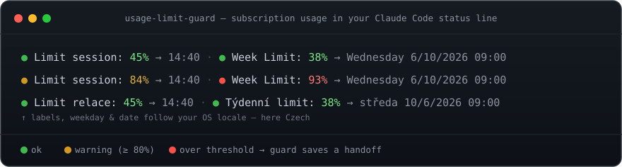

# usage-limit-guard

> Never get cut off mid-task again. **usage-limit-guard** watches your Claude subscription
> usage, shows it in the status line, injects it into context, and — at a threshold you
> choose — gracefully saves a handoff so work resumes cleanly after the limit resets.

[](https://github.com/funhunter7/usage-limit-guard/actions/workflows/ci.yml)
[](LICENSE)


<p align="center">
  
</p>
<p align="center">
  
</p>

```text
🟢 Limit session: 72% → 06:00 · 🟢 Week Limit: 39% → Wednesday 6/3/2026 10:00
```

A colored dot per window (🟢 ok · 🟡 warning · 🔴 over threshold), the live percentage, and
when it resets — a same-day reset shows just the time, a later one adds the weekday and date.

---

## Contents

- [Features](#features)
- [Requirements](#requirements)
- [Install](#install)
- [Commands](#commands)
- [Configuration](#configuration)
- [Status line layout](#status-line-layout)
- [How it works](#how-it-works)
- [Troubleshooting](#troubleshooting)

## Features

- 📊 **Live status line** — usage % and reset time for the 5-hour and 7-day windows, color-banded.
- 🌍 **Follows your system** — weekday/date names, message language, time format, and glyph
  style auto-detect from the OS/terminal (Windows & Linux). No language to configure.
- 🛟 **Graceful guard** — at your threshold the Stop hook blocks once and runs a save/handoff
  routine (or your own action) so nothing is lost; the SessionStart hook offers to resume.
- 🧭 **Both windows guarded** — the 5-hour *and* the 7-day limit trip the guard.
- ⚙️ **Menu-driven config** — `/limit-guard-config` and `/limit-guard-action` let you pick
  settings from lists instead of hand-editing JSON.
- 🔌 **No network on keystrokes** — reads native `rate_limits` from stdin; falls back to the
  OAuth usage endpoint only when needed, behind a warm cache.

## Requirements

- Node.js ≥ 18 on `PATH`
- A logged-in Claude Code. The status line uses the `rate_limits` Claude Code passes it natively; the OAuth fallback reads `~/.claude/.credentials.json`, which exists on Linux and Windows only. On macOS Claude Code keeps the login in the Keychain ([docs](https://code.claude.com/docs/en/authentication#credential-management)), so there the plugin relies on the native `rate_limits` alone (no OAuth fallback).

## Install

### From the marketplace (recommended)

In Claude Code, add this repository as a marketplace and install the plugin:

```text
/plugin marketplace add funhunter7/usage-limit-guard
/plugin install usage-limit-guard@usage-limit-guard
```

(`funhunter7/usage-limit-guard` is the GitHub `owner/repo`; `usage-limit-guard@usage-limit-guard`
is `plugin@marketplace`.) This auto-registers the hooks, the `/limit-guard-config` and
`/limit-guard-action` commands, and the `/config` options. Pull updates later with:

```text
/plugin marketplace update usage-limit-guard
/plugin update usage-limit-guard
```

### Local development

```bash
claude --plugin-dir /path/to/usage-limit-guard
```

### Status line (manual)

The status line is a user setting, so add it to `~/.claude/settings.json` yourself:

```json
{
  "statusLine": {
    "type": "command",
    "command": "node \"%LOCALAPPDATA%\\path\\to\\usage-limit-guard\\bin\\usage.mjs\" --statusline",
    "refreshInterval": 60
  }
}
```

Use the absolute path to `bin/usage.mjs`. On macOS/Linux use a normal POSIX path.

`refreshInterval` re-runs the status line on a timer (in addition to Claude Code's
event-driven updates) so the value stays current while the session is idle — in particular it
refreshes itself shortly after a limit reset, which event-only updates would otherwise miss
until your next message. `/limit-guard-setup` sets `refreshInterval: 60` for you; raise it to
reduce idle re-runs, or remove it to update only on activity. (The idle re-runs are cheap: the
plugin makes no network call until a window's reset time has actually passed.)

## Commands

| Command | What it does |
|---------|--------------|
| **`/limit-guard-config`** | Pick a setting (`threshold`, `warn_band`, per-window thresholds, `watch`, `label_style`, `reset_display`, `projection_display`, `time_format`, `style`) from menus, choose **global** or **current-project** scope, and set its value — no JSON editing. |
| **`/limit-guard-action`** | Set or clear the **guard action** (at the threshold) or the **warn action** (in the warn band), globally or per-project. |
| **`/limit-guard-status`** | Print the resolved config plus a health snapshot — token, status-line cache age, whether the status line is wired, and burn-rate history readings. |
| **`/limit-guard-stats`** | Summarize recent usage from the rolling ~7-day log: number of readings, peak 5h/7d utilization, and reset count. |
| **`/limit-guard-doctor`** | Run a self-check — Node version, OAuth token, whether the status line is wired, cache freshness, and installed-vs-latest plugin version — with a fix hint for anything failing. |
| **`/limit-guard-setup`** | Auto-wire the status line into `~/.claude/settings.json` (backing up the previous file first; it points at the marketplace clone, which survives plugin updates, rather than the versioned cache folder Claude Code deletes some days after an update), including `refreshInterval: 60` so it stays current while idle. Idempotent — a no-op when it's already wired; re-run it to add `refreshInterval` to an older wiring. In Windows Terminal it also offers to set `FORCE_HYPERLINK=1` so the status line links are clickable. |
| **`/limit-guard-legend`** | Explain every status line item (model, context bar, limits, pace arrow, projection, paths) with samples in your terminal's glyph set. See also [docs/legend.en.md](docs/legend.en.md). `/limit-guard-legend on` / `off` switches [legend mode](#legend-mode) (a block in the band above the prompt). |
| **`/limit-guard-snooze`** | Temporarily pause the guard's stop/handoff directives until the next reset (`/limit-guard-snooze clear` cancels early). The status line and notifications keep working. |

The commands that write settings go through a validated helper that preserves your other settings (the global `settings.json` is backed up to `settings.json.bak-limitguard` and written atomically).

<!-- Awesome badge: flip on once accepted into an Awesome list.
[](https://github.com/hesreallyhim/awesome-claude-code)
-->

### Languages

The status line, context directives, and command output are localized by your OS locale. English and
Czech are first-class; **German, Spanish, French, Italian, Polish, Slovak, Ukrainian, Russian,
Japanese, Chinese, Korean, Portuguese, Dutch, and Turkish** ship as best-effort translations (any
missing string falls back to English). Improvements via PR are welcome.

When `notifications` is `on`, a one-shot toast also fires when a watched window **resets**, so you
know the moment you're clear to go full speed again.

## Configuration

Settings you can change **directly in Claude Code** via `/config` (under this plugin's options):

| Option | Type | Default | Effect |
|--------|------|---------|--------|
| `threshold` | number | `95` | At or above this usage percentage the guard routine triggers. |
| `warn_band` | number | `80` | At or above this percentage (but below `threshold`) the status line turns amber. |
| `threshold_five_hour` | number | _(unset)_ | Per-window guard threshold for the `five_hour` window; overrides `threshold` for it. Blank = use the global `threshold`. |
| `threshold_seven_day` | number | _(unset)_ | Per-window guard threshold for the `seven_day` window; overrides `threshold` for it. Blank = use the global `threshold`. |
| `watch` | string | `auto` | Which limit windows to show/guard. `auto` (default) is **model-aware**: it watches the 5-hour and overall weekly windows plus any per-model weekly window in use this week (`seven_day_opus`/`seven_day_sonnet`) — so Opus-main-with-Sonnet-subagents guards both. Or give a comma-separated list to pin specific windows (`five_hour`, `seven_day`, `seven_day_opus`, `seven_day_sonnet`). |
| `guard_action` | string | `""` | What Claude should do when the threshold is reached. Leave empty for the built-in save-and-handoff routine. |
| `warn_action` | string | `""` | Gentle, **non-blocking** advice appended to context while usage is in the warn band (below `threshold`). Leave empty for the built-in message. |
| `label_style` | enum | `full` | Window labels: `full` (`Limit session:` / `Week Limit:`) or `short` (`5h` / `7d`) to save line width. |
| `reset_display` | enum | `clock` | Reset time as `clock` (`→ 06:00`), `relative` (`→ in 2h13m`), or `both` (`→ 06:00 (in 2h13m)`). |
| `projection_display` | enum | `off` | When `on`, adds a burn-rate estimate like `📈 ~1h40m to 90%` for the soonest-to-breach window, from the recent usage trend. |
| `layout` | enum | `compact` | `compact` (model, context bar, limit windows, project paths — see [Status line layout](#status-line-layout)) or `classic` (the v0.12 limits-only line, unchanged). |
| `show_model` | bool | `true` | Show the active model name (compact layout). |
| `show_context` | bool | `true` | Show the context-window bar (compact layout). |
| `pace_arrow` | bool | `true` | Add `↑` after a window's percentage when usage runs at least 10 points ahead of the elapsed window time. |
| `window_display` | enum | `all` | `all` shows every watched window; `nearest` only the one closest to its threshold. |
| `show_paths` | bool | `true` | Show project, worktree and scratch folder segments. |
| `scratch_dir` | string | `""` | Folder for the scratch segment (relative to the project). Empty = Claude Code's built-in scratchpad. |
| `background` | enum | `warn` | Compact status line backgrounds: `off`, `bar` (whole line on a dark bar, padded to `COLUMNS` when set), `tiles` (every segment its own background, no separators) or `warn` (a limit in the amber or red band gets a black-on-amber / white-on-red tile; context only when red, ≥80 %). 16-color equivalents in the basic and ascii tiers; none under `NO_COLOR`; classic layout unaffected. |
| `bar_style` | enum | `pill` | Context bar glyphs: `pill`, `block`, `shade`, `square`, `dot`, `rect`, `line`, `braille` or `smooth`. Falls back to `block` in terminals without the glyphs. |
| `notifications` | enum | `off` | When `on`, pops up an OS notification once when a window enters the warn band or crosses the threshold (macOS/Linux/Windows, best-effort). |

### Auto-detected (not in the `/config` dialog)

These follow your environment, so `/config` doesn't prompt for them. Override on demand via
`/limit-guard-config` or JSON:

| Option | Default | Effect |
|--------|---------|--------|
| `locale` | `system` | Language for the weekday/date and messages — follows the **OS locale** (Windows & Linux), so you needn't set a language. Override with a BCP-47 tag like `cs-CZ`, `de-DE`, `ja-JP`. |
| `time_format` | `system` | Reset time format: `system` (follow OS), `12` (`→ 5:00 PM`), or `24` (`→ 17:00`). |
| `style` | `auto` | Terminal tier of the status line: `auto` (detect terminal), `emoji` (= full), `basic` or `ascii` (safe for legacy cmd/conhost). |

### Setting values

- **`/config`** — pick the plugin and edit the values interactively (easiest).
- **`/limit-guard-config`** — choose values from menus, global or per-project.
- **`~/.claude/settings.json`** — set them under `pluginConfigs` by hand:
  ```json
  {
    "pluginConfigs": {
      "usage-limit-guard@usage-limit-guard": {
        "options": {
          "threshold": 90,
          "guard_action": "Save a handoff to RESUME.md and stop."
        }
      }
    }
  }
  ```
  Claude Code passes these to the plugin as `CLAUDE_PLUGIN_OPTION_<KEY>` env vars.

### Per-project override

Drop `.claude/limit-guard.json` and `.claude/limit-guard.md` (copy from `templates/`; `limit-guard.md` is
English, `limit-guard.cs.md` the Czech version) into a project to override these settings for that
project only. The project root is used (not a subfolder Claude has `cd`'d into).

### Precedence (most specific wins)

| Priority | Source |
|----------|--------|
| 1 (highest) | Per-project `.claude/limit-guard.json` |
| 2 | `/config` option for hooks/commands (`CLAUDE_PLUGIN_OPTION_*`, injected by Claude Code) |
| 3 | `/config` option read from `settings.json` `pluginConfigs` (covers the status line) |
| 4 (lowest) | Built-in default |

> The status line is a plain user setting, so Claude Code does not inject the option env vars
> for it. The plugin therefore reads your `/config` options straight from `settings.json`, so
> they apply to the status line too — not only to the hooks.

## Status line layout

The default `compact` layout puts the most useful facts on one line (colors and links where your terminal supports them):

```text
🤖 Opus 5.5 │ 🧠 ▰▰▰▰▱▱▱▱▱▱ 42% │ ⏳ 5h 84%↑ 20:08 │ 📅 7d 25% Wed 09:00 │ 🏠 my-project │ 🔀 rule-fixes │ 📁 scratchpad
```

Model (🤖), context-window bar (🧠) (green below 50 %, amber below 80 %, red above), each watched limit
window with its reset time, the optional projection, then project, worktree (only inside a linked git
worktree) and scratch folder. `↑` means usage is at least 10 points ahead of the elapsed window time.
Segments without data are left out. Set `layout: classic` for the old limits-only line; the
`--context` text injected into Claude is never affected. Every item is explained in
[docs/legend.en.md](docs/legend.en.md) (Czech: [docs/legend.cs.md](docs/legend.cs.md)) and by `/limit-guard-legend`.

The look follows your terminal (`style: auto`):

| Tier | Detected as | Look |
|------|-------------|------|
| full | Windows Terminal, iTerm2, WezTerm, VS Code, Kitty, Ghostty, Alacritty, modern VTE terminals (not under tmux/screen) | 256 colors, `▰▱` bar, `│`, emoji icons, clickable links |
| basic | tmux/screen, JetBrains, Konsole, Terminal.app, other Unix terminals | 16 colors, `█░` bar, `│`, no emoji, no links |
| ascii | legacy Windows console (cmd/PowerShell host), ConEmu, `TERM=dumb` | 16 colors, `[####------]` bar, `\|`, `^` arrow, no links |

`NO_COLOR` removes all colors.

**Clickable links.** In the full tier the project/worktree/scratch segments open the folder. Claude Code
hides terminal links in **Windows Terminal** unless `FORCE_HYPERLINK=1` is set, so
`/limit-guard-setup` offers to add it to `settings.json` (`env`) — note that it then applies to every
link Claude Code prints. `/limit-guard-doctor` shows an info line while it is missing; `FORCE_HYPERLINK=0`
turns links off everywhere.

### Legend mode

Legend mode adds a short explanation block, one line per part (the color samples drawn in real colors, the rest dim) under the **ⓘ legend** button the plugin draws above the
prompt (what the model, context bar, `5h` / `7d`, `↑`, reset time, project, worktree and scratch folder
segments mean; Czech or English by your locale). The status line itself stays one row. Because the band
redraws on a press, the block appears and disappears instantly.

```text
🤖 model – who is answering right now
🧠 conversation memory – up to 50% · up to 80% · more; when it runs out, Claude forgets details
⏳ session limit (5h) – usage of the 5-hour window, time = when it resets
📅 weekly limit (7d) – usage of the weekly window
number color: fine · careful (warn band) · threshold crossed
↑ – usage runs ahead of time by 10+ points
📈 – estimate of when the limit runs out (only when enabled)
🏠 project – click to open the folder
🔀 worktree – separate copy of the project (git worktree)
📁 scratch folder – Claude's working files
```

Switch it with the button (hotkey `l` while the band has focus; needs Claude Code 2.1.287 or newer,
older versions just don't show the button) or with `/limit-guard-legend on` / `off`. Both toggle the
flag file `.limit-guard-legend` in your Claude config directory (`CLAUDE_CONFIG_DIR`, default `~/.claude`);
`/limit-guard-status` shows its state.

## How it works

- **Status line** — `🟢 Limit session: 72% → 06:00 · 🟢 Week Limit: 39% → Wednesday 6/3/2026 10:00`
  (emoji = band, % always shown). Labels follow the OS locale — Czech shows `Limit relace:` /
  `Týdenní limit:`. A same-day reset shows just the time (`→ 06:00`); a reset on another day
  adds the full weekday and a date so the 7-day window is unambiguous. The date follows the OS
  locale's field order with slashes and a year — US `6/3/2026` (month first), Europe `3/6/2026`
  (day first).
- **UserPromptSubmit / Stop hooks** — inject the live limit; at/above the threshold they
  instruct Claude to run the guard routine. The Stop hook blocks once per reset window (so it
  never loops) and covers both the 5-hour and 7-day windows.
- **SessionStart hook** — offers to resume from the handoff file after a reset.
- **Rendering & fallback** — on a legacy Windows console (cmd/conhost) where colored emoji
  don't render, `style: auto` falls back to ASCII (`[OK] Limit session: 72% -> 06:00 | ...`).
  A missing/expired token shows `🔑 sign in`.

The status line reads rate-limit usage from the native `rate_limits` data Claude Code passes
on stdin (Pro/Max, after the first API response), so the per-keystroke path makes no network
call. It falls back to `GET https://api.anthropic.com/api/oauth/usage` (your local OAuth token
— the same source as `/usage`) when that data is unavailable (API-key sessions, before the
first response, older Claude Code). Hooks always call `getUsage()`, which reads the same ~45s
cache the status line keeps warm — so they hit the OAuth endpoint only when that cache is cold.

Once a watched window's reset time passes, the native `rate_limits` (and the warm cache
populated from them) are stale until Claude Code makes its next API response, so the status
line stops trusting them and re-queries the OAuth endpoint for the fresh post-reset value —
guaranteeing the displayed number is correct the moment the script next runs after a reset.

## Troubleshooting

The status line and hooks stay silent on failure (so a network blip never breaks your prompt).
Two environment variables help when the reading looks wrong:

| Env var | Effect |
|---------|--------|
| `CLAUDE_LIMIT_GUARD_DEBUG=1` | Print fetch/cache/auth decisions to **stderr** (`[limit-guard] …`). Set anything other than ``/`0`/`false`/`no` to enable. |
| `CLAUDE_LIMIT_GUARD_CC_VERSION` | Override the `claude-code/<version>` User-Agent sent to the usage endpoint, in case a pinned version is ever rejected. |

## Development

```bash
npm test          # node --test (500+ tests)
npm run lint      # eslint .
npm run check     # lint + test
npm run test:mod  # band mod tests (hooks/band.test.tsx) via `claude plugin test .`
```

`npm test` does not run the `.tsx` mod tests and CI does not either (it has no `claude` binary); run
`npm run test:mod` locally after touching `hooks/band.tsx`.

`tsconfig.json` extends `.claude-plugin/types/tsconfig.json`, a git-ignored file of Claude Code mod typings
that is generated locally, not committed. On a fresh clone it is absent, so an editor may report an unresolved
`extends` and miss type hints for `hooks/band.tsx`; tests, lint and `npm run test:mod` do not need it.

Tests pin `TZ=Europe/Prague` for deterministic wall-clock formatting; CI runs them on Node
18/20/22 and lints on Node 22.

## License

[MIT](LICENSE)
